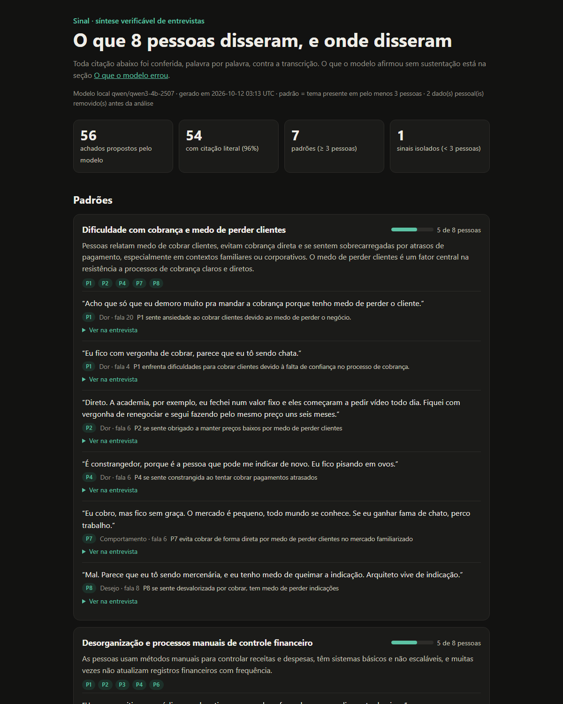

# Sinal — interview synthesis you can check

A command-line tool that turns user-interview transcripts into themes, where **every quote is
checked word by word against the transcript** before it reaches the report, and the model is scored
against ground truth instead of trusted. It runs on a **local model** (LM Studio), so transcripts
never leave the machine.

**Demo report:** https://bernardobonecher.github.io/sinal/ (8 synthetic interviews, generated by a 4B model on a laptop CPU)



## The problem

Product teams run discovery interviews and then spend hours turning them into findings. Asking an
LLM to summarize is fast, but the summary can put words in people's mouths: a paraphrase presented as
a quote, a quote that was never said, or the interviewer's suggestion reported as the user's opinion.
Once that reaches a roadmap discussion, nobody goes back to the transcript to check.

**Who it's for:** PMs, POs and UX researchers who synthesize interviews and need to defend each
finding with what the user actually said.

## How it works

```
transcripts (.md) ─→ redact personal data ─→ extract insights ─→ verify quotes ─→ group into themes ─→ validate ─→ report.html
                      (code)                   (model)            (code)           (model)             (code)      + evals
```

1. **Redact.** E-mails, phone numbers, CPF and CNPJ are replaced before any text reaches the model.
2. **Extract (model).** For each interview, the model returns up to 8 insights, each with a claim,
   a type (pain, behavior, desire), a literal quote and the turn it came from, as structured JSON.
3. **Verify (code).** Each quote is searched in the transcript after normalizing case and punctuation:
   - found in the cited participant turn → kept
   - found in another participant turn → kept, turn corrected
   - found only in what the **interviewer** said → rejected
   - close but not literal (≥ 80% similar) → rejected as a paraphrase
   - nothing close → rejected as not found
4. **Group (model).** The model proposes themes as lists of insight ids.
5. **Validate (code).** Unknown ids are dropped, participants are counted from the ids, and only a
   theme backed by **3 or more different people** is called a pattern. Fewer is an isolated signal.
6. **Report.** One self-contained HTML file: patterns with their quotes (each opens the surrounding
   conversation), isolated signals, ungrouped findings, and a section listing **what the model got wrong**.

The model proposes; code decides what counts as evidence.

## Results on the demo set

The 8 interviews are synthetic, written for this project, with ground truth planted on purpose
([evals/golden.json](evals/golden.json)): 5 recurring themes, 2 single-person mentions, 2 leading
questions the participant rejects, and personal data to redact. Model: Qwen3 4B Instruct (Q4_K_M) in
LM Studio, on an Intel i5-10210U laptop with no GPU.

| Check | Result |
|---|---|
| Quotes that were literal participant speech | **96%** (54 of 56) |
| Planted themes recovered as a pattern | **80%** (4 of 5) |
| Reported patterns that match a planted theme | **57%** (4 of 7) |
| People placed in a theme they contradict | 0 |
| Findings that echo a rejected leading question | 0 |
| Personal data in the output | 0 |
| Verified findings the model placed in a theme | 63% |
| Model time | 44 min, 6,063 tokens generated (2.3 tokens/s on CPU) |

What the numbers hide, and the report shows:

- **One quote was invented.** For P6 the model quoted *"A planilha funciona. Eu não preciso de nada
  complicado."* P6 never said the second sentence. Rejected.
- **One quote was almost right.** For P1 it wrote *"Eu larguei. Ele queria…"*; P1 said *"…usei duas
  semanas e larguei. Ele queria…"*. 99% similar, still not what was said. Rejected.
- **One theme was missed.** Four people mix work and personal money, but the model scattered those
  findings across three themes, so no pattern reached three people.
- **Two themes were split in two.** "Trouble charging clients" and "late payment as emotional strain"
  are the same planted theme; so are "manual financial control" and "preference for simplicity". That
  is what drags precision to 57%. They are not invented themes. The third unmatched pattern, "no
  control over real earnings", mixes part of the missed money-mixing theme with worries about tax.

## Mistakes I made building it

Both are fixed and covered by tests, and both are worth knowing if you build something similar.

**An unbounded JSON schema let the model loop.** The first theme-grouping call generated over 3,500
tokens for an answer that needs about 1,300: the 4B model, constrained to a JSON grammar, kept
repeating items in an array with no upper bound. Fix: `maxItems` and `maxLength` on every array and
string, a `max_tokens` ceiling, and a hard error when a response stops at the token limit, so a
truncated answer is never cached as if it were valid.

**The first eval overstated recall.** It matched planted themes to reported ones by *who* was in them,
so a theme about invoices "matched" a planted theme about spreadsheets because the same three people
appear in both, and it reported 100% recall. Reading the matches one by one showed the problem. Now
matching is one-to-one, ranked by Jaccard overlap, and a reported theme must have at least half of its
findings on the planted subject. Recall dropped to the honest 80%.

## Run it

Requires Python 3.10+ and nothing else at runtime (standard library only).

**Replay the demo without a model** (uses the cached responses committed in `runs/qwen3-4b`):

```bash
python -m sinal run data/interviews --out runs/qwen3-4b --offline
```

**Run with a local model:**

1. Install [LM Studio](https://lmstudio.ai), then download and load a model:
   ```bash
   lms get qwen/qwen3-4b-2507
   lms load qwen/qwen3-4b-2507 --context-length 8192
   lms server start
   ```
2. Analyze a folder of transcripts:
   ```bash
   python -m sinal run data/interviews --out runs/my-run --model qwen/qwen3-4b-2507
   ```
   Any OpenAI-compatible server works: set `SINAL_LLM_URL` (default `http://localhost:1234/v1`).
3. Re-score an existing run, or rebuild its report: `python -m sinal eval runs/my-run`

**Tests:** `pip install -r requirements-dev.txt && python -m pytest` (35 tests, including a fake model
server for the client).

### Transcript format

```markdown
---
id: P1
perfil: Designer gráfica, 31 anos
---
**Entrevistadora:** Como você controla quem já pagou?
**P1:** Numa planilha do Google...
```

The speaker whose label equals `id` is the participant; anyone else is the interviewer.

## Decisions

- **Literal or nothing.** A paraphrase can be a fine summary, but it is not evidence. The report keeps
  the claim and the quote separate so you can see the model's interpretation next to the words.
- **Local model by default.** Interview transcripts are personal data; a local model keeps them on the
  machine. The trade-off is speed (44 min on a laptop CPU) and a smaller model, which is exactly why
  verification matters.
- **Code owns the counting.** Whether a theme is a "pattern" depends on how many different people back
  it, and that is counted from the ids, never taken from the model's prose.
- **Synthetic data with planted answers.** It is the only way to measure recall and precision. Real
  interviews have no answer key.
- **Cache keyed by the exact request.** Re-running is free and deterministic, and the published demo
  can be rebuilt by anyone without a model.

## Limitations

- Exact-match verification rejects a quote with one changed word. That is deliberate, but it also
  rejects harmless differences like a dropped filler word.
- Leading-question detection beyond "quote taken from the interviewer" is a keyword heuristic, listed
  for human review rather than counted as fact.
- Name redaction is out of scope; transcripts identify people by code.
- Eight short synthetic interviews are a small test. Results on real, messier transcripts will differ.

Built with Claude Code. The interviews, ground truth and all names and contacts in them are fictional.

Code under the [MIT License](LICENSE).
